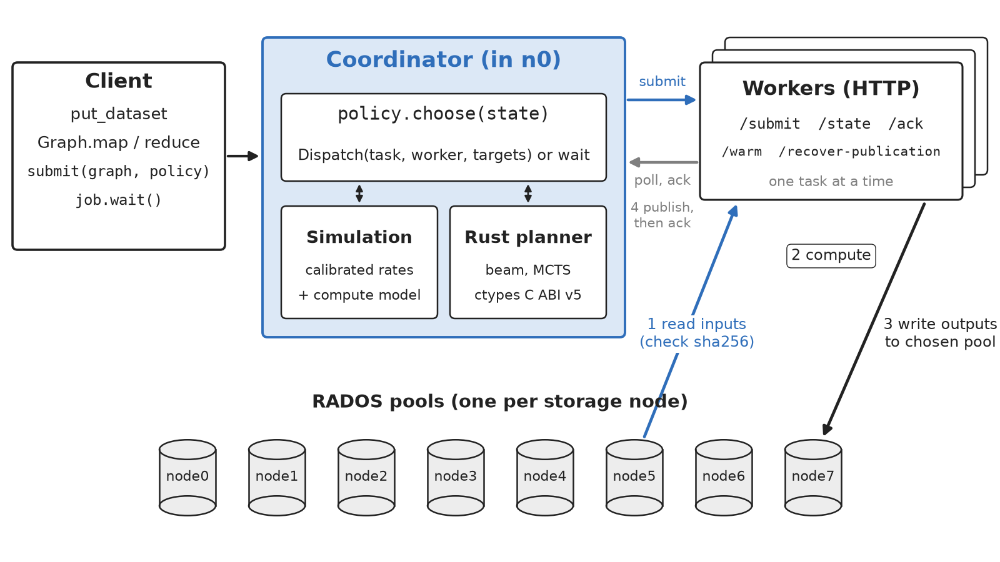
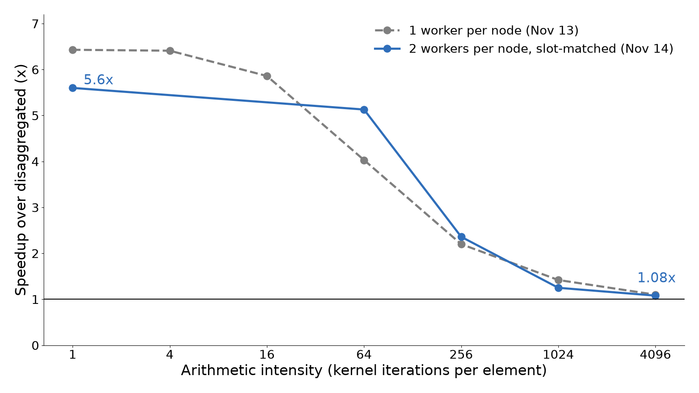
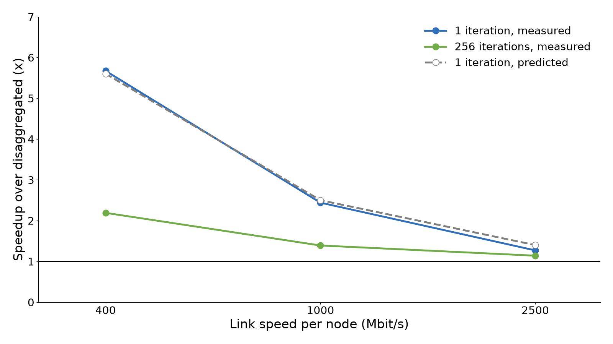
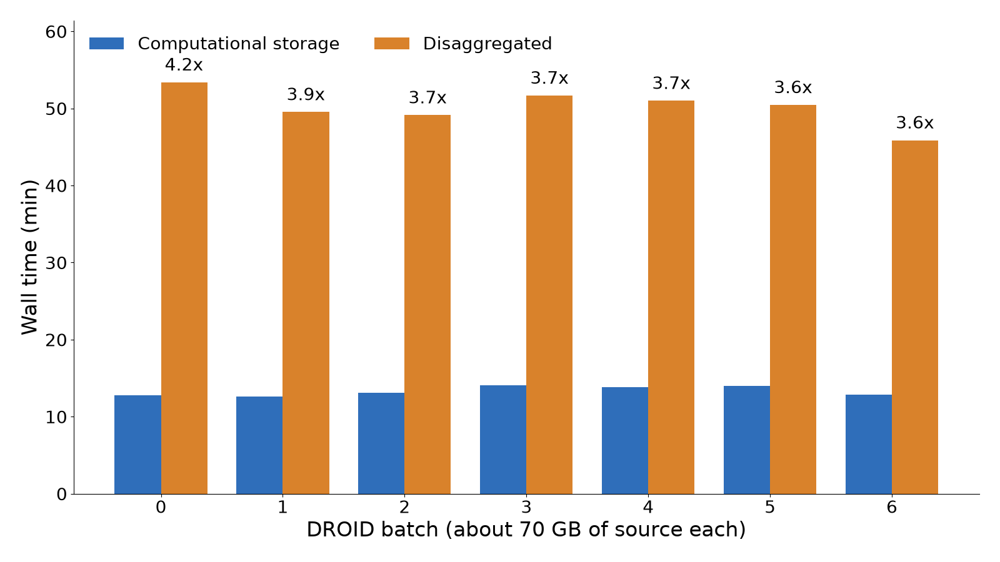
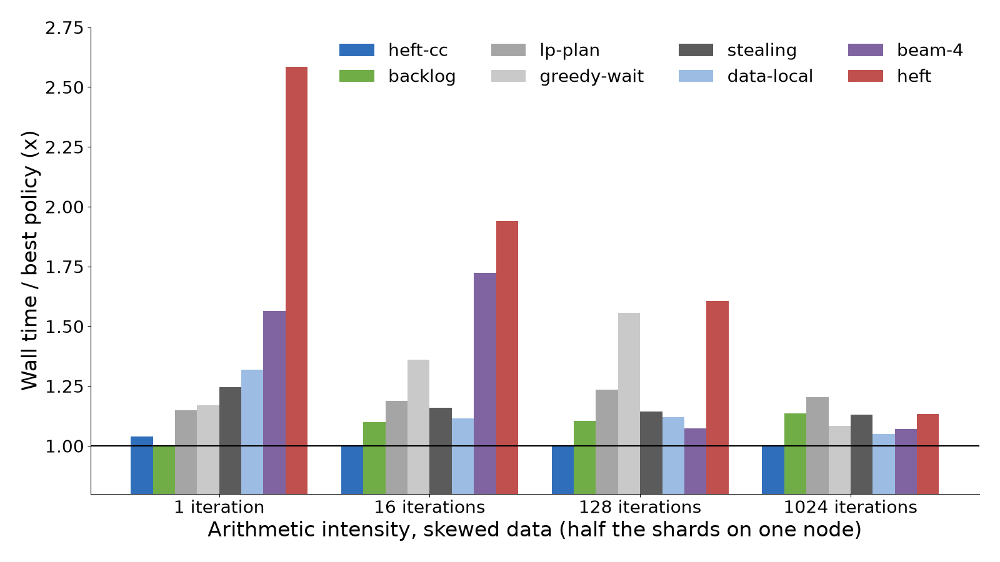
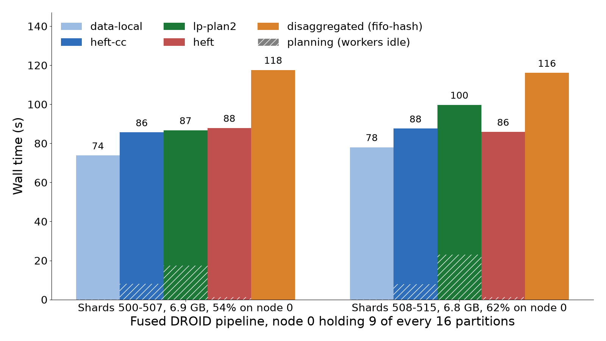

# Design document, part 2: many storage nodes and scheduling

*Demo 3, `demo-3` branch. Part 1, the slice API on one storage node, is
[design-document.md](design-document.md). The code for this part is in
[`cephdag/`](../cephdag); its results, raw rows and figures are in
[`demo3-cephdag/`](demo3-cephdag/README.md).*

## Why

Part 1 sliced DROID on the node that stores it. That moved 99.998% less data over the
network and took the same time: 33.4 s in place, 33.7 s after sending everything. With one
storage node, a network of up to 12.5 Gbit/s and a slower disk, moving the data cost
nothing.

That leaves two questions.

1. When does computing next to the data save time, and how much?
2. Once the data is spread over many storage nodes, where should each task run?

To answer them we built a Ceph cluster of eight storage nodes that can also compute, a
baseline that computes away from the same data, and a scheduler interface with a dozen
policies behind it. What we found:

* **Computing at the storage saves what moving the data would have cost.** With equal
  workers on both sides it is 5.6x faster when tasks mostly read and write and 1.08x
  faster when they mostly compute; 5.7x faster on 400 Mbit/s links and 1.3x on 2.5 Gbit/s
  links. It was never slower.
* **On 496 GB of DROID it is 3.76x faster,** 1.55 h against 5.85 h, and moves 6 GB over
  the network where the baseline moves 4.1 TB.
* **Uneven data needs a scheduler that counts link time.** When one node holds half the
  data, running every task where its data is overloads that node, and everything moved
  off it shares that node's one link. HEFT ignores the sharing and loses to simply running
  each task where its data is. HEFT with link time booked beats both, and a linear program
  solved once beats that.
* **On the real pipeline, planning has to get cheaper.** With DROID concentrated on one
  node, the linear program's schedule is the fastest to execute, but the 17 to 23 s spent
  computing it costs more than it saves. Running each task where its data is wins.

## 1. Architecture

### The lab


One host runs 17 Docker containers, described by
[`infra/labs/cephdag8.json`](../cephdag/infra/labs/cephdag8.json) and managed by
[`infra/lab.py`](../cephdag/infra/lab.py).

| Containers | Role | Each gets |
| --- | --- | --- |
| `cephdag8-n0..n7` | storage node: one Ceph OSD with its own pool, and a worker | 3 CPUs, 6 GiB |
| `cephdag8-c0..c7` | compute-only node: a worker and no storage | 2 CPUs, 3 GiB |
| `cephdag8-router` | carries every link, each shaped to 400 Mbit/s | 0.25 CPU |

Pool `node3` lives only on node 3's OSD, so an object's pool says which disk holds it.

One cluster runs both systems. Only the place where the workers run changes:

* **Computational storage** (`cs`): the workers run in the storage nodes.
* **Baseline** (`disagg`): the workers run in the compute-only nodes, so every input and
  every output crosses a link.

`cs2` and `disagg2` are the same two with two workers per node, 16 in all.

### The software



A client describes its work as a graph of tasks over stored partitions and submits it
with the name of a scheduling policy:

```python
from cephdag import Client, Cluster, Graph

client = Client(
    Cluster.load("cephdag/clusters/cephdag8-cs.json"),
    models="/results/calibration/cephdag8-cs/models.json",
)
data = client.dataset("my-dataset")

graph = Graph()
mapped = graph.map("map@1", data, iterations=32, ratios=[0.5])
graph.reduce("join@1", mapped, iterations=1, ratios=[0.5])

job = client.submit(graph, "heft-cc")
job.wait(timeout=600)
for ref in job.outputs():
    print(ref.pool, ref.key)
```

`map@1` and `join@1` are registered functions. `iterations` sets how much compute each
task does and `ratios` how large each output is relative to its input. The scheduler
uses both.

What happens after `submit`:

1. **The coordinator** ([`coordinator.py`](../cephdag/cephdag/coordinator.py), in node 0)
   knows where every stored partition and every finished output is, and what each worker
   is doing. At every event it asks the policy what to do next.
2. **A policy** is one method, `choose(state)`. It returns
   `Dispatch(task, worker, targets)`: run this task on that worker and store output *i*
   on node `targets[i]`. Or it returns `None`, which means wait. Where a task runs and
   where its outputs go are separate choices.
3. **A worker** ([`worker.py`](../cephdag/cephdag/worker.py)) reads its inputs from Ceph
   and checks their checksums, runs the function, writes each output to the pool it was
   given, and publishes one completion record.
4. **Verification.** After the last task every final output is read back and checked, and
   one digest of all outputs is recorded. Every policy and both modes must produce the
   same digest.

The policies ([`cephdag/policies/`](../cephdag/cephdag/policies)):

| Policy | Rule |
| --- | --- |
| `fifo-hash` | The baseline's. Oldest ready task to the first free worker; outputs placed by a hash of their name, as Ceph would. |
| `data-local` | Run the task where the fewest input bytes have to move, and keep its outputs there. |
| `heft` | HEFT list scheduling. It plans each transfer as if it had the link to itself. |
| `heft-cc` | HEFT that books time on each node's send and receive link, and moves a task only if that finishes it 5% sooner. |
| `lp-plan2` | Solves one linear program for how many tasks of each kind each node should take, then follows that plan. |
| `backlog`, `stealing`, `greedy`, `greedy-wait` | Cheap rules for moving work off a busy node. |
| `beam-N`, `native-mcts-heuristic-N` | Lookahead search in a Rust simulator ([`native/`](../cephdag/native)). |

### The workloads

* **Synthetic.** One task per 64 MiB shard. The function repeats a multiply, an add and a
  tanh over the shard `iterations` times, so one number sets how much compute each byte
  gets. Shards are spread evenly, or skewed so that node 0 holds 65 of 128.
* **DROID.** The preprocessing pipeline on DROID 1.0.1: decode every camera frame and
  resize it to 128x128, encode lossless video, compute per-frame statistics, and write
  the robot state to Parquet. The resized frames are 2.16x the size of the source and two
  later tasks read them. A fused variant does all four steps in one task and never stores
  the frames.

## 2. Design decisions

**Containers on one host, not Kubernetes and Rook.** The proposal planned Rook. We needed
16 nodes on one Ceph cluster, a baseline on identical data, and room for 500 GB of DROID.
Docker on one large machine gave us that under one script. The price is that all the
nodes share that machine (section 5).

**The baseline is the same cluster with the workers moved.** Both systems read the same
bytes from the same disks through the same links, and a worker gets the same CPU and
memory in either. A difference in time can only come from where the work ran.

**Equal numbers of workers.** The headline comparisons use 16 workers on each side. With
8 against 16, the baseline pulled ahead on compute-heavy work (0.72x at 4096 iterations),
which measured the worker count and not the storage.

**One pool per node, one copy of the data.** "Local" then means the node's own disk, and
the scheduler knows where every byte is. Ceph's default placement would scatter each
dataset over all the nodes.

**Links at 400 Mbit/s.** A node reads its own disk at 264 to 392 MB/s and a link carries
47 MB/s, so moving data is the expensive step, as it is for a large dataset on a shared
network. Experiment 2 raises the links to 2.5 Gbit/s to show what happens when it is not.

**Planning time counts.** The coordinator dispatches nothing while a policy is thinking,
so a policy is judged on wall time with its own planning included.

**Book the links (`heft-cc`).** HEFT assumes every transfer has its link alone. On the
skewed data it planned 31 moves off node 0 and a finish at 11.5 s; node 0's one link
needed 44 s to carry them. `heft-cc` reserves time on the sending and the receiving link
for every transfer, so its plan never overlaps two moves out of one node.

**Plan once (`lp-plan2`).** A linear program decides how many tasks each node takes from
each other node, first for the earliest finish and then for the fewest bytes moved. It is
solved once per job, in about 50 ms on the synthetic graphs, and a dispatcher follows it.
The dispatcher holds a worker for a busy link when its next task is a planned move, and
lets a node that has finished early take back tasks stored on it.

**Predict before running.** Every new policy first ran in a simulator that shares each
disk and link fairly among the transfers using it. Over 47 combinations of policy and
workload its median error against the lab was 2.5%, and 42 were within 10%. A policy got
lab time only with its prediction written down first.

## 3. Setup

**The host.** One x86-64 Linux machine with Docker, Python 3, and the `ipip` and `sch_tbf`
kernel modules. Ours has 32 CPU threads and 123 GiB of RAM. The lab uses 72 GiB of RAM and
448 GiB of SSD for the OSDs (ours grew to about 700 GiB on btrfs). Raw DROID and the
results need another 510 GB on any disk. `lab.py plan` checks the budget before anything
is created.

**Build the lab.** Set `results_dir` in `infra/labs/cephdag8.json` to a directory on the
large disk, then:

```bash
git clone -b demo-3 https://github.com/ec528-fall26/comp-storage && cd comp-storage/cephdag

# what the image is built from; the build checks every hash
python3 -m pip download --no-deps --only-binary :all: -d deps/wheels \
    --python-version 3.9 --implementation cp --abi cp39 \
    --platform manylinux_2_28_x86_64 --platform manylinux2014_x86_64 \
    -r infra/requirements-linux-amd64.lock -r infra/requirements-droid-linux-amd64.lock
mkdir -p deps/rust
for part in rustc rust-std cargo; do
    curl -fL --output-dir deps/rust -O \
        https://static.rust-lang.org/dist/$part-1.85.0-x86_64-unknown-linux-gnu.tar.xz
done

L="--lab infra/labs/cephdag8.json"
python3 infra/lab.py $L plan          # dry run and budget; touches nothing
mkdir -p state/cephdag8 && echo '{"approved": true}' > state/cephdag8/approval.json
python3 infra/lab.py $L build         # the image: Ceph 20.2.4, Python 3.9, the Rust planner
python3 infra/lab.py $L up            # 17 containers, their networks, 8 OSD volumes
python3 infra/lab.py $L bootstrap     # Ceph, and pools node0..node7 pinned to their OSDs
python3 infra/lab.py $L mode cs --functions cephdag.droid
python3 infra/lab.py $L shape 400     # every link at 400 Mbit/s
python3 infra/lab.py $L verify cs     # each pool on its own OSD, each link at its rate
```

`lab.py` refuses to create anything until `approval.json` exists. `lab.py stop` and
`resume` keep the data across a reboot.

**Download DROID** (only for the DROID experiments). This fetches shards 0 to 552 and
2047 from the public bucket, 501.5 GB, and checks each against its published MD5. A rerun
resumes.

```bash
python3 ../docs/demo3-cephdag/droid_download.py <results_dir>/droid/raw --bytes 500e9 --also 2047
```

**Calibrate.** The schedulers need each node's measured read, write and compute rates.
Shard 2047 is held out for this.

```bash
C="docker exec cephdag8-n0 python3 -m"
RATE=376.7    # the slowest link rate that verify measured
$C experiments.droid_ingest --shards 2047 --resolution 128 --placement 0,1,2,3,4,5,6,7 \
    --source-dir /results/droid/raw --cluster cephdag/clusters/cephdag8-cs.json
$C experiments.calibrate --network-mbit $RATE --droid droid-128-02047 \
    --cluster cephdag/clusters/cephdag8-cs.json --output /results/calibration/cephdag8-cs

python3 infra/lab.py $L mode disagg --functions cephdag.droid
python3 infra/lab.py $L shape 400
python3 infra/lab.py $L verify disagg
$C experiments.calibrate --network-mbit $RATE --droid droid-128-02047 \
    --cluster cephdag/clusters/cephdag8-disagg.json --output /results/calibration/cephdag8-disagg \
    --storage-from /results/calibration/cephdag8-cs/calibration.json

for mode in cs disagg; do             # models for two workers per node and for fused DROID
    base=/results/calibration/cephdag8-$mode/models.json
    $C experiments.derive_models $base /results/derived-models/cephdag8-${mode}2/models.json \
        --cluster cephdag/clusters/cephdag8-${mode}2.json --fused
    $C experiments.derive_models $base /results/derived-models/cephdag8-$mode-fused/models.json --fused
done
```

**Run the tests** on any machine, without Docker or Ceph. There are 263; three need a real
DROID shard at `CEPHDAG_DROID_SHARD` and skip without it.

```bash
uv venv -p 3.9 .venv && uv pip install -p .venv numpy==2.0.2 -r requirements-droid.txt
cargo build --release --offline --manifest-path native/Cargo.toml
.venv/bin/python -m unittest discover -s tests -t .
```

## 4. Experiments and results

Every experiment is one command, run from `cephdag/` on the host:

```bash
python3 experiments/campaign.py run experiments/campaigns/<spec>.json
```

A campaign switches the lab between the two systems, checks the links, runs every case
under every policy, verifies every output, and writes one row per run to
`<results_dir>/campaigns/<spec>/`. It resumes where it stopped. `plan` in place of `run`
prints the steps and a time estimate.

All 422 runs behind this section passed verification. Their rows are in
[`demo3-cephdag/rows/`](demo3-cephdag/rows), and
[`make_figures.py`](demo3-cephdag/demo-data/make_figures.py) rebuilds every table and
figure from them. Times are medians over repeats. A speedup is taken within each repeat,
then the median.

### Experiment 1. How much it saves depends on how much the task computes

`demo3-slots.json`, 1.4 h. 16 GiB in 256 tasks, spread evenly, 16 workers on each side.

| Iterations | Computational storage | Baseline | Speedup |
| ---: | ---: | ---: | ---: |
| 1 | 11.6 s | 64.2 s | 5.60x |
| 64 | 12.9 s | 65.8 s | 5.13x |
| 256 | 31.1 s | 71.8 s | 2.36x |
| 1024 | 95.0 s | 118.9 s | 1.25x |
| 4096 | 362.6 s | 392.4 s | 1.08x |

The baseline moves 21.5 GB in every run and computational storage at most 0.27 GB. At 1
iteration a baseline task reads for 2.34 s, computes for 0.02 s and writes for 0.55 s.
The same task at the storage takes 0.27, 0.07 and 0.08 s. As the compute grows, the
minute the baseline spends moving data becomes a smaller share of the run.

At 256 GiB, 16 times the data, the speedups are 4.87x at 1 iteration and 2.21x at 256
(`demo3-scale.json`, 4.1 h, 8 workers on each side, one run each).



### Experiment 2. It also depends on the network

`netsweep-1000.json`, `netsweep-2500.json`, `netsweep-400.json`, 28 min together. 8 GiB,
16 workers on each side.

| Link speed | Speedup at 1 iteration | At 256 iterations |
| ---: | ---: | ---: |
| 400 Mbit/s | 5.67x | 2.19x |
| 1000 Mbit/s | 2.44x | 1.39x |
| 2500 Mbit/s | 1.27x | 1.14x |

Computational storage takes 5.5 to 6.0 s at every speed, because it sends nothing. The
baseline falls from 32.1 s to 7.5 s. Before the run we predicted 5.6x, 2.5x and 1.4x.

At 2.5 Gbit/s a link carries about 300 MB/s, as much as a node reads from its own disk,
and the advantage is almost gone. Part 1's AWS testbed, with a faster network and a
250 MB/s disk, is past that point, which is why its two runs took the same time.



### Experiment 3. DROID at 496 GB

`demo3-droid.json`, 16.7 h. Shards 0 to 549, 64,144 tasks, in 7 batches of about 70 GB
because the cluster holds 448 GiB. 8 workers on each side.

| | Computational storage | Baseline |
| --- | ---: | ---: |
| Wall time | 5,595 s (1.55 h) | 21,059 s (5.85 h) |
| Moved over the network | 6.2 GB | 4,107 GB |

That is 3.76x. Most of it comes from the stored frames, which the baseline writes once
and reads twice across the network. With the fused pipeline, which never stores them, the
speedup on three shards is 1.79x where the unfused pipeline gives 4.30x
(`demo3-slots-droid.json`, 13 min, one run each).



### Experiment 4. Uneven data needs a scheduler that counts link time

`sched-skew.json`, 2.4 h; `sched-lp.json` and `sched-lp-low.json`, 1.0 h. Computational
storage only. 8 GiB with 65 of 128 shards on node 0, 3 repeats. Seconds:

| Policy | 1 iteration | 16 | 128 | 1024 |
| --- | ---: | ---: | ---: | ---: |
| `heft` | 45.5 | 39.2 | 56.4 | 108.1 |
| `data-local` | 23.2 | 22.5 | 39.3 | 100.1 |
| `heft-cc` | 18.3 | 20.2 | 35.1 | 95.4 |
| `lp-plan2` | 12.8 | 16.0 | 33.4 | 88.6 |

`lp-plan2` ran in later sessions, in which `heft-cc` took 18.3, 19.0, 35.7 and 95.0 s.
It was the fastest policy in every repeat and moved 0.5 to 3.0 GB where `heft-cc` moved
2.4 to 4.5 GB.

On evenly spread data `heft-cc` and `lp-plan2` move almost nothing and tie `data-local`,
while `heft` moves 5 to 8 GB and runs 17 to 37% slower (`sched-uniform.json`,
`sched-lp-uniform.json`).



### Experiment 5. On the real pipeline, planning time eats the gain

`sched-droid.json`, 0.6 h. Fused DROID, shards 500 to 515 in two batches, with node 0
holding 54% and 62% of the bytes. 8 workers on each side, one run per batch.

| | Batch 1 | Batch 2 | Of which planning |
| --- | ---: | ---: | ---: |
| `data-local` | 73.8 s | 78.0 s | 0 s |
| `heft-cc` | 85.6 s | 87.6 s | 8 s |
| `lp-plan2` | 86.7 s | 99.7 s | 17 s, 23 s |
| `heft` | 87.9 s | 85.9 s | 1 s |
| Baseline | 117.6 s | 116.1 s | 0 s |

Without its planning time `lp-plan2`'s schedule is the fastest (69.3 and 76.6 s) and
moves the fewest bytes. It plans slowly here because every DROID partition has its own
size, which gives the linear program one group of variables per task, 217 and 224, where
the synthetic graph has 8. Grouping partitions by size would shrink it. We have not done
that.



### Experiment 6. Search does not pay

`sched-mcts.json`, 0.7 h. On the skewed data, MCTS with 128 iterations per decision was
49% and 44% slower than `heft-cc` at 1 and 128 iterations (26.4 against 17.7 s, 53.5
against 37.1 s) and moved the most data of any policy. At 1024 iterations the two are
within the drift between runs. Gumbel MCTS, tested in the simulator with a perfect model
of the cluster, did no better than random restarts with the same budget, so it did not
get lab time ([GUMBEL.md](demo3-cephdag/GUMBEL.md)).

## 5. Limitations

* **One machine.** All 16 nodes and the router are containers on one host. They share
  its memory and one SSD, and the links are emulated. Real disks and a real network
  would differ.
* **Not Kubernetes and Rook,** which the proposal planned.
* **One copy of the data.** Losing an OSD loses its pool.
* **Few repeats.** Two or three per synthetic case. The 4096-iteration case, the 256 GiB
  runs and each DROID batch ran once.
* **The host's storage slowed over the weekend,** by 9 to 30% between days. Numbers are
  compared within one campaign, never across days.
* **Tasks and outputs are placed; inputs are not.** Data is placed once when it is
  loaded. The proposal's idea of placing related inputs together is not built.
* **Two systems.** Part 1's slice API does not submit to this scheduler, and this
  cluster has run neither the slice nor the Demo 2 conversion.
