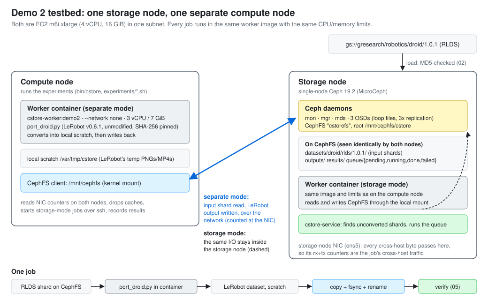

# Design Document

*Demo 2 version (due 10/21 in the `demo-2` branch). The proposal this implements is
[`design-proposal.md`](design-proposal.md).*

Demo 2 milestone, from the proposal: *a single-node Ceph cluster with an end-to-end
load → format conversion → write-back path, a background conversion service, and an
established separate-compute baseline*, demonstrated by running the complete conversion
on a compute node separate from storage on fixed inputs, verifying the output, and
recording total runtime and cross-host bytes with a documented command.

| Milestone item | Where it is | Shown by |
| --- | --- | --- |
| Single-node Ceph cluster | `infra/storage-node.sh` (MicroCeph, CephFS) | experiment 01 |
| Load | `src/cstore/loader.py` | experiment 02 |
| Format conversion | Hugging Face's `port_droid.py`, unmodified, in `src/worker/` image | experiments 03, 04 |
| Write-back | `publish_tree` in `src/cstore/worker.py` | experiments 03, 04, 05 |
| Background conversion service | `src/cstore/service.py`, `src/cstore/jobqueue.py` | experiment 06 |
| Separate-compute baseline, runtime and cross-host bytes | `src/cstore/bench.py`, `src/cstore/netcount.py` | experiments 03, 07 |
| Output verification | `src/cstore/verify.py` | experiment 05 |

## 1. Architecture



**Testbed.** Two EC2 `m6i.xlarge` instances (4 vCPU, 16 GiB, Ubuntu 24.04) in one subnet.

* The **storage node** runs a single-node Ceph 19.2 cluster (MicroCeph): one monitor,
  one manager, one metadata server and three OSDs on loop files, with 3-way replication
  across the OSDs. It serves one CephFS file system, `cstorefs`, which the node also
  mounts at `/mnt/cephfs`.
* The **compute node** has no storage of its own; it mounts the same CephFS over the
  network at the same path.
* Everything the system reads or writes lives under `/mnt/cephfs/cstore` (`CSTORE_ROOT`),
  so a path means the same thing on both nodes:

  ```
  datasets/droid/rlds/1.0.1/   DROID RLDS shards (input)
  outputs/<run>/<mode>/...     LeRobot datasets (output)
  jobs/  results/              job specs and measurement records
  queue/{pending,running,done,failed}/   the background service's queue
  ```

**Jobs.** A job is one function applied to a declared list of input files (its
dependencies), producing one output directory (`src/cstore/jobs.py`). The function in
Demo 2 converts one DROID 1.0.1 shard from RLDS to the LeRobot v3 format, using Hugging
Face's own converter, `examples/port_datasets/port_droid.py` from LeRobot v0.6.1, run
unmodified. A job's dependencies are the shard's record file plus `dataset_info.json`
and `features.json`. Demo 3's placement policy will read these lists.

**Running a job** (`src/cstore/runner.py`, `src/cstore/worker.py`). The worker always
runs in the same Docker image (`cstore-worker:demo2`) with the same limits (3 vCPU,
7 GiB on `m6i.xlarge`) and no network (`--network none`); CephFS is bind-mounted from
the host. Inside, in three timed phases:

1. **convert**: `port_droid.py` reads the shard from CephFS through TensorFlow Datasets
   and writes the LeRobot dataset (Parquet + three AV1 MP4 streams) to local scratch disk;
2. **write-back**: the finished dataset is copied to CephFS, each file fsynced, then
   published with one directory rename, so readers never see a partial dataset;
3. **report**: a JSON result (bytes in/out, phase times, CPU time, episode/frame counts).

**Execution modes** (`src/cstore/bench.py`). The only difference is where the worker runs:

* `separate`, the baseline: on the compute node, so the shard crosses the network on the
  way in and the LeRobot dataset on the way back;
* `storage`: on the storage node, so the same reads and writes stay inside one host.

Before each job, both nodes drop their page caches and the OSDs drop their BlueStore
caches. The driver (on the compute node) reads both nodes' NIC byte counters immediately
before and after the job.

**Background conversion service** (`src/cstore/service.py`, systemd unit
`cstore-service`). Runs on the storage node. Every 5 s it looks for loaded shards that
have no LeRobot version under `outputs/service/`, queues a job for each, then claims
the oldest queued job and runs it exactly like a direct job. The queue is a set of
directories on CephFS (`src/cstore/jobqueue.py`): a worker claims a job by renaming its
file from `pending/` to `running/`. Any node can submit (`bin/cstore submit`) or watch
(`bin/cstore status`) without another service.

**Code map.**

| Path | Contents |
| --- | --- |
| `bin/cstore` | command-line entry point (Python standard library only; runs with the system `python3`) |
| `src/cstore/` | job specs, runner, worker, loader, queue, service, benchmark driver, verification, report |
| `src/worker/` | `Dockerfile` and pinned `requirements.txt` for the worker image |
| `src/third_party/lerobot/port_droid.py` | Hugging Face's converter, vendored unmodified (Apache-2.0) |
| `infra/` | `aws/up.sh`, `aws/down.sh`, `deploy.sh`, `storage-node.sh`, `compute-node.sh`, `mount-cephfs.sh`, the service unit |
| `experiments/` | one script per claim (section 4) |
| `tests/` | unit tests (`python3 -m unittest discover -s tests`) |

## 2. Design decisions

**Single-node Ceph from MicroCeph, not Rook yet.** The proposal puts Rook on Kubernetes
in Demo 3, together with multiple storage nodes. For one node, MicroCeph (the Ceph
"squid" 19.2 track) gets to a working CephFS in a few commands that we script, and it
handles the single-host case: with fewer than three hosts it places replicas across
OSDs instead of hosts, so 3-way replication works on one machine. *Alternatives:*
`cephadm` (more steps, needs a container runtime and spare block devices); Rook now (needs
Kubernetes plus raw devices, and buys nothing until there are several nodes).

**Three loop-file OSDs.** They work on any VM without attaching extra volumes. They are
backed by the root EBS volume, so they say nothing about disk performance; that is fine
for a traffic measurement. Real devices (one EBS volume per OSD) are a one-line change
in `infra/storage-node.sh` if Demo 3 needs them.

**CephFS, kernel client.** As in the proposal: existing converters read and write file
paths. `infra/mount-cephfs.sh` falls back to `ceph-fuse` if the kernel has no `ceph`
module. Both nodes run the same AMI and kernel, so they always use the same client.

**Reuse Hugging Face's converter, unmodified and pinned.** `port_droid.py` is vendored
from LeRobot tag v0.6.1 (commit `7e241bd6`); its SHA-256 is checked before every run, so
both modes provably run the same transformation. The image pins LeRobot 0.6.1,
TensorFlow 2.21 (CPU), TensorFlow Datasets 4.9.10 and every other package
(`src/worker/requirements.txt`).

**Same container image, limits and cache state in both modes.** The image is built once
on the storage node and copied to the compute node (`docker save | docker load`), so
both run the same image ID (checked by experiment 01 and recorded in every result).
`--network none` guarantees a worker can only touch data through the CephFS mount, so
every byte it moves is CephFS traffic that the NIC counters see.

**Convert to local scratch, then publish.** LeRobot writes every frame as a PNG and every
episode as a temporary MP4 under the dataset directory before assembling the final
files. With that directory on CephFS, the separate-compute mode would move several times
the output size over the network. Hugging Face's own pipeline also converts locally and
uploads the finished dataset. Copy + fsync + rename makes "readable processed outputs"
a single instant we can time.

**Measure cross-host bytes at the storage node's NIC.** With one storage node, every
byte that crosses a host boundary in this testbed enters or leaves that node, so the
receive + transmit counters of its interface (`/proc/net/dev`) count each transfer once:
input reads, output writes and CephFS protocol overhead. Traffic between the storage
node's own CephFS client and its OSDs goes over loopback and is not counted, which is
exactly the saving we want to see. The counters also include ssh and CephFS session
traffic; the storage-mode figure bounds that noise. *Alternatives:* per-flow counters
(`nftables`) or Ceph's own performance counters, both more setup for the same answer
with one storage node. Demo 3, with several storage nodes, needs per-node accounting.

**A queue made of files on CephFS.** Rename is atomic, so claiming a job needs no lock
service, and any node can submit or inspect jobs with ordinary file operations.
*Alternatives:* Redis or RabbitMQ (another service to run), Kubernetes Jobs (planned for
Demo 3's serverless API).

**Fixed real inputs, small by default.** DROID 1.0.1 shard 2 (649 MB, the smallest of the
first ten), checked against a pinned size and MD5 (`src/cstore/loader.py`), keeps a full
run near 30 minutes. `SHARDS="2 8"` adds shard 8 (686 MB); any of the 2048 shards works.

**Things that did not work, and what we did instead.**

* *Hugging Face's directory layout.* The porting guide passes `--raw-dir .../droid/1.0.1`,
  but TensorFlow Datasets 4.9 reads that as dataset `droid`, *config* `1.0.1`, and then
  finds no version directory under it. The data therefore lives in
  `datasets/droid/rlds/1.0.1/` and the converter is given `datasets/droid/rlds`.
* *Running as the host user inside the container.* Workers run with the host user's
  uid so CephFS files belong to that user. With no matching passwd entry in the image,
  PyTorch's `getpass.getuser()` crashed; the runner now sets `USER` and `LOGNAME`.
* *CPU limits on small machines.* `docker run --cpus=3` fails on a 2-vCPU host. Limits
  are derived from the machine (vCPUs − 1, half the RAM up to 8 GiB), and experiment 01
  checks both nodes ended up with the same values.
* *Comparing outputs byte for byte.* LeRobot writes the keys of `meta/stats.json` in
  whatever order its parallel encoders finish, so two runs differ in that file only.
  The verifier compares JSON files after sorting keys; everything else must match exactly.

## 3. Setup

**Hardware assumptions.** Two x86-64 hosts running Ubuntu 24.04 that reach each other
on a private network with all TCP allowed between them, with passwordless `sudo` and
internet access (apt, snap, Docker Hub, PyPI, download.pytorch.org, storage.googleapis.com).
We use `m6i.xlarge` (4 vCPU, 16 GiB) for both: the storage node with a 100 GB disk,
the compute node with 40 GB. Both nodes must be the same type.

**Your own machine** needs `bash`, `ssh`, `rsync` and `git`; for the AWS route also
[AWS CLI v2](https://docs.aws.amazon.com/cli/latest/userguide/getting-started-install.html)
configured for an account with the course credits.

**Software the setup installs.** MicroCeph `squid/stable` (Ceph 19.2.3), `ceph-common`
and `docker.io` from Ubuntu 24.04. Worker image: Ubuntu 24.04, Python 3.12, torch
2.11.0+cpu, LeRobot 0.6.1, TensorFlow 2.21.0 (CPU), TensorFlow Datasets 4.9.10, PyAV
15.1.0, NumPy 2.2.6 (complete list: `src/worker/requirements.txt`).

### Quick check on one machine (no cloud, no Ceph)

Any Linux machine with Docker, or a Mac with Docker Desktop (the image builds natively
for Apple Silicon). A local directory stands in for CephFS and synthetic shards with the
DROID 1.0.1 layout stand in for the download.

```bash
git clone -b demo-2 https://github.com/ec528-fall26/comp-storage && cd comp-storage
experiments/00_smoke_local.sh        # ~10 min the first time (image build), ~2 min after
```

### The testbed on AWS (the experiments' setting)

```bash
git clone -b demo-2 https://github.com/ec528-fall26/comp-storage && cd comp-storage
aws sts get-caller-identity          # confirm the CLI points at the account with credits

infra/aws/up.sh                      # ~5 min: key pair, security group, 2 instances
infra/deploy.sh                      # ~15 min: both nodes configured, ends with "all checks passed"

# log in to the compute node (deploy.sh prints this line with the real address)
ssh -i infra/aws/.state/cstore-demo2.pem ubuntu@<compute-public-ip>
cd comp-storage
experiments/run_all.sh               # ~30 min: experiments 01-07
exit

infra/aws/down.sh                    # deletes everything up.sh created
```

Two `m6i.xlarge` cost about $0.38/hour in `us-east-1`; run `infra/aws/down.sh` when done.
If `up.sh` stops part way, `down.sh` removes whatever it had created. New AWS accounts
may have an on-demand vCPU quota below the 8 vCPUs needed (`VcpuLimitExceeded`): request
an increase in Service Quotas, or set `INSTANCE_TYPE=m6i.large` (2 vCPU, 8 GiB per node;
conversions then take roughly twice as long).

### Any two Ubuntu 24.04 hosts (NERC, lab machines, ...)

```bash
SSH_KEY=~/.ssh/your_key infra/deploy.sh ubuntu@<storage-host> ubuntu@<compute-host>
```

then log in to the compute node and run `cd comp-storage && experiments/run_all.sh`.

### What `infra/deploy.sh` does, if you prefer to do it by hand

```bash
# on both hosts: a copy of this repository in ~/comp-storage
# storage node:
sudo infra/storage-node.sh                     # MicroCeph, CephFS, mount, worker image, service unit
# copy ~/cstore-client/{ceph.conf,ceph.client.cstore.keyring} from the storage node to the compute node, then:
sudo infra/compute-node.sh <storage-private-ip> ~/cstore-client
# compute node: let it ssh to the storage node, and give it the identical image
cat ~/.ssh/id_ed25519.pub            # append to ~/.ssh/authorized_keys on the storage node
ssh ubuntu@<storage-private-ip> 'docker save cstore-worker:demo2' | docker load
bin/cstore check
```

Settings live in `infra/cluster.env` on each node (written by the setup scripts); any
of them can be overridden with an environment variable (see `src/cstore/config.py`).

**If the image build cannot reach download.pytorch.org**, build with PyPI's torch
wheels instead (larger image, same versions): prefix `infra/deploy.sh` (or
`experiments/00_smoke_local.sh`) with
`DOCKER_BUILD_ARGS="--build-arg TORCH_INDEX_URL=https://pypi.org/simple"`.

## 4. Running the experiments

Run on the **compute node** from `~/comp-storage`, in order (`experiments/run_all.sh`
runs 01-07), except 00, which runs on any Linux machine or Mac with Docker. Every script prints what it
measures. Results are saved under `/mnt/cephfs/cstore/results/`.

### Experiment 0: the pipeline works end to end

| | |
| --- | --- |
| Supports | "load → convert → write-back → verify works, directly and through the background service" |
| Command | `experiments/00_smoke_local.sh` |
| Expected runtime | ~10 min first time (image build), ~2 min after |
| Expected output | three `VERIFY OK` blocks; the direct and service outputs of shard 2 reported `byte-identical`; last line `SMOKE TEST PASSED` |

### Experiment 1: the testbed is as described

| | |
| --- | --- |
| Supports | "single-node Ceph cluster; CephFS mounted on a separate compute node; identical worker image and limits on both nodes" |
| Command | `experiments/01_check_cluster.sh` |
| Expected runtime | ~10 s |
| Expected output | Ceph status with 1 mon, 1 mgr, 1 mds and 3 OSDs up, `cstorefs` active; then every check line `OK` and `all checks passed`. A `WARN` on Ceph health right after setup (placement groups settling) is not fatal; re-run after a minute. |

### Experiment 2: fixed, real inputs are loaded into CephFS

| | |
| --- | --- |
| Supports | "inputs are DROID 1.0.1 RLDS shards, byte-identical to the published files" |
| Command | `experiments/02_load_droid.sh` (`SHARDS="2 8"` to add shard 8) |
| Expected runtime | ~1 min per shard, once |
| Expected output | an `md5 ok` (or `already present and verified`) line per file, the shard's episode count, and the files listed from the compute node's mount: `dataset_info.json` (31403 bytes), `features.json` (16841), `droid_101-train.tfrecord-00002-of-02048` (648726823) |

### Experiment 3: separate-compute baseline

| | |
| --- | --- |
| Supports | the baseline row of the results table: runtime and cross-host bytes when the worker runs on the compute node |
| Command | `experiments/03_baseline_separate.sh` (starts a new run ID that 04, 05 and 07 reuse) |
| Expected runtime | ~8 min per shard |
| Expected output | `[separate] shard-00002: ok; wall … s (convert … s, write-back … s); cross-host … MB; output … MB; episodes N of N`. **Match:** cross-host between 1.0× and 1.15× of (input + output), i.e. the 649 MB shard plus the LeRobot output plus protocol overhead |

### Experiment 4: the same jobs on the storage node

| | |
| --- | --- |
| Supports | "running on the storage node keeps the data off the network" |
| Command | `experiments/04_storage_node.sh` |
| Expected runtime | ~8 min per shard |
| Expected output | `[storage] shard-00002: ok; …; cross-host … MB; …; episodes N of N`. **Match:** cross-host under 1% of experiment 3's (ssh and CephFS session traffic only). Wall time is reported, not a pass/fail criterion (section 5) |

### Experiment 5: outputs are correct and equivalent

| | |
| --- | --- |
| Supports | "both modes produce equivalent, valid LeRobot datasets" |
| Command | `experiments/05_verify_outputs.sh` |
| Expected runtime | ~1-2 min |
| Expected output | `VERIFY OK` for every output (episodes equal the input shard's count from `dataset_info.json`; frame counts agree across the episode index, the Parquet data and all three videos; first and last frames decode through LeRobot's loader), and per shard `vs …: byte-identical` |

### Experiment 6: background conversion service

| | |
| --- | --- |
| Supports | "loaded data is converted in the background with no manual step" |
| Command | `experiments/06_background_service.sh` |
| Expected runtime | ~8 min per loaded shard, plus ~1 min of verification |
| Expected output | `bin/cstore status` snapshots every 20 s showing one job per loaded shard (`svc-shard-00002` by default) running and then done, the service's log (`queued svc-shard-00002: new shard 2 has no converted output`, `running …`, `finished …`), then `VERIFY OK` per output. Re-running finds nothing new; to repeat, delete `outputs/service` and `queue` under `/mnt/cephfs/cstore` |

### Experiment 7: results table and chart

| | |
| --- | --- |
| Supports | the numbers and chart in the slides |
| Command | `experiments/07_report.sh` |
| Expected runtime | seconds |
| Expected output | a Markdown table per job and mode, totals, and closing lines with the cross-host reduction, the runtime ratio and output equivalence; saved as `results/<run>/summary.md`, `summary.json`, `summary.svg` |

### Unit tests

`python3 -m unittest discover -s tests` (seconds; no Docker or Ceph): network counter
parsing, settings, job specs, queue claiming (including a lost race), atomic publish,
the converter's pinned hash, the loader's checksum handling, and the report.

## 5. Claims and limitations

**What the artifact supports.**

* The load → convert → write-back path runs end to end on CephFS with Hugging Face's
  unmodified converter, and its outputs pass LeRobot's own loader (experiments 0, 3-5).
* For the separate-compute baseline, cross-host traffic is about input + output, and
  the same job on the storage node moves almost nothing between hosts (experiments 3, 4, 7).
* Both modes produce the same dataset, byte for byte (experiment 5).
* A background service converts loaded data with no manual step (experiment 6).

**Measured results on the AWS testbed.**

> TODO (team): paste `results/<run>/summary.md` from `experiments/07_report.sh` here
> after running on the testbed, with the date and run ID. These are the numbers the
> slides use.

**Limitations.**

* **One storage node makes locality total by construction.** Every input is local to
  the storage node, so experiment 4 is the best case. It says nothing yet about placing
  related inputs together or about partial locality; that is Demo 3, with several
  storage nodes and the dependency-aware scheduler.
* **No speedup is expected for this workload.** The converter is CPU-bound: in our
  calibration on synthetic data it spent about 45 ms of CPU per step (each step has three
  camera frames, each written as a PNG and then AV1-encoded), so a 649 MB shard takes
  minutes of computation but only seconds of transfer on the VPC network. On the storage
  node the worker also shares four vCPUs with the Ceph daemons. The proposal's goal of
  "~70% less network traffic while preserving execution time" is tested here by the
  traffic saving and by checking that runtime does not get worse.
* **The traffic count includes background noise.** ssh between the nodes, CephFS
  session upkeep and the cloud agents (time sync, SSM) also cross the storage node's NIC;
  the storage-mode figure shows how small that is. The setup scripts hold snap refreshes
  and stop apt's periodic downloads so they cannot land inside a measurement. The count
  is only valid with one storage node (Demo 3 needs per-node, per-peer accounting).
* **Loop-file OSDs share the root EBS volume**, so storage throughput is not representative.
* **Byte-identical outputs assume identical CPUs.** Both nodes are the same instance
  type. On different CPUs the AV1 encoder could produce different bytes; the verifier
  then reports whether the decoded content still matches.
* **Synthetic data only in experiment 0.** It has DROID's layout and schema but not its
  image content, so its compression ratio and speed are not DROID's.

**How this was tested before the cluster run.** The unit tests and the smoke test
(experiment 0) pass. The whole experiment flow (01, 03, 04, 05, 07, plus the service
and the queue) also ran on a single VM against a hand-built Ceph 19.2.3 cluster mounted
with `ceph-fuse`, with both "nodes" on that one machine, so its traffic numbers were
meaningless. That run exercised the Ceph commands in `infra/storage-node.sh`, CephFS
reads and writes, atomic publishes, queue claiming and verification on real CephFS. It
did not exercise MicroCeph, the kernel CephFS client, or two separate hosts. The AWS CLI
calls in `infra/aws/` were checked for syntax only. The AWS run above is the first
end-to-end run of those parts.
