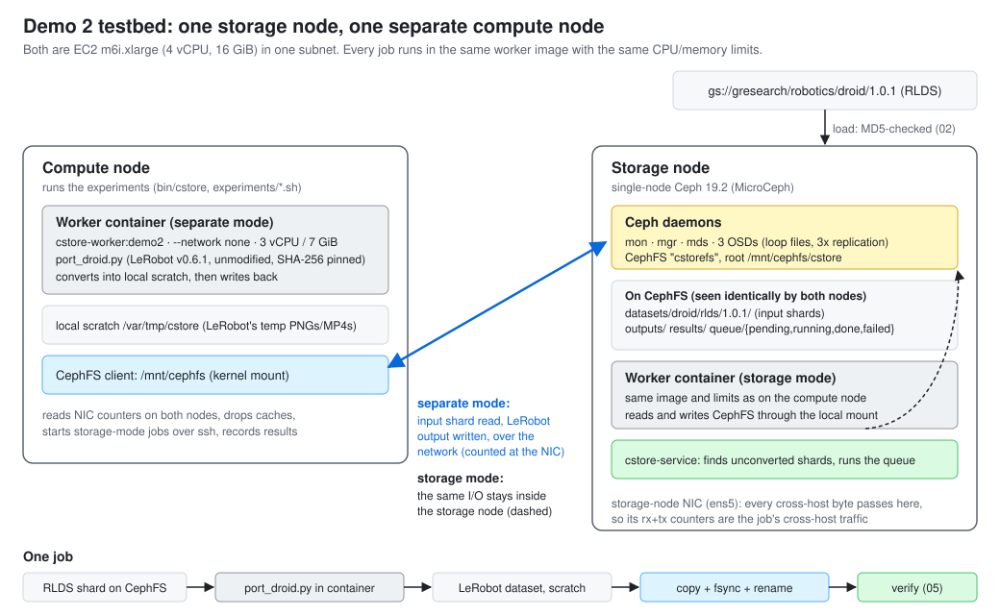

# Design Document

*Demo 3 version (due 11/16, `demo-3` branch). The Demo 2 version is in the `demo-2`
branch. The proposal this implements is [`design-proposal.md`](design-proposal.md).*

Demo 3 milestone, from the proposal: *multiple storage nodes deployed with Kubernetes and
Rook, a serverless API, and a first dependency-aware placement or scheduling policy*,
demonstrated by submitting jobs through the API and showing reduced network transfer on
matching inputs with equivalent outputs, with runtime and transferred bytes for both modes.

| Milestone item | State | Where it is | Shown by |
| --- | --- | --- | --- |
| Serverless API | Built; ran on AWS from a laptop over plain HTTP | `src/cstore/api.py`, `bin/cstore-client` | experiments 11, 12 |
| Reduced network transfer, equivalent outputs, runtime and bytes for both modes | Measured on AWS with one storage node | section 5 | experiment 12 |
| Multiple storage nodes (Kubernetes and Rook) | Not in this version | TODO(team) | |
| Dependency-aware placement or scheduling | Not in this version | TODO(team) | |

**What changed since the proposal.** The proposal's workload was converting all of DROID
from RLDS to LeRobot. Demo 2 built that conversion, and Demo 3 keeps it. Demo 3 adds a
second workload that a user asks for over the API: **a keyword slice**. The user sends a
few keywords, and the storage node keeps only the DROID episodes whose instruction
contains all of them, writing a smaller RLDS dataset next to the data. Two reasons:

* **Users want a slice, not the dataset.** DROID 1.0.1 is about 1.7 TB in RLDS. People
  training on it usually want a subset: one task, one lab, one skill. Today they download
  everything and filter afterwards.
* **RLDS has no index.** Its shards are packed for download and parallel reading, and
  episodes are in random order on purpose. The schema (`features.json`) says what an
  episode contains, but nothing says where a given episode is. Any selection means
  reading whole shards, so reading them where they are stored saves moving them.

The Demo 2 converter stayed CPU-bound (section 5): moving its data cost no
visible time. The slice is the opposite: it reads a lot and computes little.

## 1. Architecture


### A request, step by step

1. **Client** (`bin/cstore-client`, on the user's laptop). The only thing the user
   touches. One command with keywords; it sends the request, follows the job and prints
   a summary. Python standard library only.
2. **API server** (`src/cstore/api.py`, FastAPI, on the storage node). Checks the request
   and turns it into a job file in the queue. It never runs code or touches the data.
3. **Job queue** (Demo 2, `src/cstore/jobqueue.py`). Folders on CephFS: `pending/`,
   `running/`, `done/`, `failed/`. A job's state is the folder its file is in.
4. **Background service** (Demo 2, `src/cstore/service.py`). A loop that checks the queue
   every second, claims the oldest pending job by renaming its file, and starts a worker.
5. **Worker container** (Demo 2, `src/cstore/runner.py`, `src/cstore/worker.py`). The
   same image and limits as Demo 2, with no network. It looks up the job's function by
   name in `src/cstore/functions/__init__.py`, runs it into local scratch, and publishes
   the result to CephFS with one rename.
6. **Slice filter** (`src/cstore/functions/droid_rlds_slice.py`, runs in the worker).
   Reads every episode of every shard and keeps the matching ones, unchanged.
7. **CephFS.** The shards are read from it and the slice is written back to it. Only the
   request and a status summary cross the network.

The client keeps asking `GET /jobs/<id>` until the job is done or failed. The API answers
from the queue folders and the worker's result record.

### The request

```
POST /jobs        {"keywords": ["put", "mug"], "max_episodes": 20}   ->  202 {"job_id": "slice-…", "status": "queued"}
GET  /jobs/<id>   ->  {"status": "queued" | "running" | "done" | "failed", "output": "outputs/slices/<id>",
                       "episodes_scanned", "episodes_kept", "bytes_scanned", "bytes_out"}   (counts once done)
GET  /health      ->  {"ok": true}
```

* **Matching.** An episode is kept if one of its instructions contains every keyword, as
  whole words, ignoring case. DROID episodes carry one to three crowd-written instructions
  (`language_instruction`, `_2`, `_3`).
* **Limit.** The filter stops after `max_episodes` matches (default 20).
* **Rejected requests.** Missing or empty keywords, unknown fields, `max_episodes` below 1
  (HTTP 422 or 400). With no shards loaded, 503.
* **Output.** `outputs/slices/<job_id>/` holds one TFRecord file with the kept episodes,
  byte for byte, `features.json` (copied), `dataset_info.json` (copied, shard list
  rewritten) and `manifest.json` (keywords, the kept episodes, bytes in and out). It
  loads with the standard TFDS reader like the original. With no matches, only
  `manifest.json` is written, because TFDS cannot load an empty dataset.

The job the API writes uses the Demo 2 job format unchanged: `function` is
`droid_rlds_slice`, `inputs` are every loaded shard, `output` is the slice folder, and
`params` carries the keywords and `max_episodes`.

### Testbed

The same two nodes as Demo 2 (below): one storage node and one compute node,
both EC2 `m6i.2xlarge` in one subnet. For Demo 3 we loaded DROID shards 2–7 (5.9 GB,
290 episodes). The storage node's loop-file OSDs leave about 14 GB usable, so more
shards need a larger `OSD_SIZE`. The API listens on port 8000, which the security group
opens only to the user's IP address.

### Code map (Demo 3 additions)

| Path | Contents |
| --- | --- |
| `bin/cstore-client` | the client (standard library only) |
| `src/cstore/api.py` | the API server |
| `src/cstore/functions/droid_rlds_slice.py` | the slice filter |
| `src/cstore/functions/__init__.py` | one added line registering the filter (the only change to Demo 2 code) |
| `experiments/11_demo3_serve.sh` | starts the API server and the service on one machine |
| `tests/test_slice_e2e.py` | end-to-end tests on synthetic shards |

### Demo 2 testbed and execution (unchanged)



**Testbed.** Two EC2 `m6i.2xlarge` instances (8 vCPU, 32 GiB, Ubuntu 24.04) in one subnet.

* The **storage node** runs a single-node Ceph 19.2 cluster (MicroCeph): one monitor,
  one manager, one metadata server and three OSDs on loop files, with 3-way replication
  across the OSDs. It serves one CephFS file system, `cstorefs`, which the node also
  mounts at `/mnt/cephfs`.
* The **compute node** has no storage of its own; it mounts the same CephFS over the
  network at the same path.
* Everything the system reads or writes lives under `/mnt/cephfs/cstore` (`CSTORE_ROOT`),
  so a path means the same thing on both nodes:

  ```
  datasets/droid/rlds/1.0.1/   DROID RLDS shards (input)
  outputs/<run>/<mode>/...     LeRobot datasets (output)
  jobs/  results/              job specs and measurement records
  queue/{pending,running,done,failed}/   the background service's queue
  ```

**Jobs.** A job is one function applied to a declared list of input files (its
dependencies), producing one output directory (`src/cstore/jobs.py`). The function in
Demo 2 converts one DROID 1.0.1 shard from RLDS to the LeRobot v3 format, using Hugging
Face's own converter, `examples/port_datasets/port_droid.py` from LeRobot v0.6.1, run
unmodified. (The public DROID files lack six per-episode fields that script reads; they
are supplied before each episode reaches it, see section 2.) A job's dependencies are the
shard's record file plus `dataset_info.json` and `features.json`. Demo 3's placement policy will read these lists.

**Running a job** (`src/cstore/runner.py`, `src/cstore/worker.py`). The worker always
runs in the same Docker image (`cstore-worker:demo2`) with the same limits (7 vCPU,
8 GiB on `m6i.2xlarge`) and no network (`--network none`); CephFS is bind-mounted from
the host. Inside, in three timed phases:

1. **convert**: `port_droid.py` reads the shard from CephFS through TensorFlow Datasets
   and writes the LeRobot dataset (Parquet + three AV1 MP4 streams) to local scratch disk;
2. **write-back**: the finished dataset is copied to CephFS, each file fsynced, then
   published with one directory rename, so readers never see a partial dataset;
3. **report**: a JSON result (bytes in/out, phase times, CPU time, episode/frame counts).

**Execution modes** (`src/cstore/bench.py`). The only difference is where the worker runs:

* `separate`, the baseline: on the compute node, so the shard crosses the network on the
  way in and the LeRobot dataset on the way back;
* `storage`: on the storage node, so the same reads and writes stay inside one host.

Before each job, both nodes drop their page caches and the OSDs drop their BlueStore
caches. The driver (on the compute node) reads both nodes' NIC byte counters immediately
before and after the job.

**Background conversion service** (`src/cstore/service.py`, systemd unit
`cstore-service`). Runs on the storage node. Every 5 s it looks for loaded shards that
have no LeRobot version under `outputs/service/`, queues a job for each, then claims
the oldest queued job and runs it exactly like a direct job. The queue is a set of
directories on CephFS (`src/cstore/jobqueue.py`): a worker claims a job by renaming its
file from `pending/` to `running/`. Any node can submit (`bin/cstore submit`) or watch
(`bin/cstore status`) without another service.

**Code map.**

| Path | Contents |
| --- | --- |
| `bin/cstore` | command-line entry point (Python standard library only; runs with the system `python3`) |
| `src/cstore/` | job specs, runner, worker, loader, queue, service, benchmark driver, verification, report |
| `src/worker/` | `Dockerfile` and pinned `requirements.txt` for the worker image |
| `src/third_party/lerobot/port_droid.py` | Hugging Face's converter, vendored unmodified (Apache-2.0) |
| `infra/` | `aws/up.sh`, `aws/down.sh`, `deploy.sh`, `storage-node.sh`, `compute-node.sh`, `mount-cephfs.sh`, the service unit |
| `experiments/` | one script per claim (section 4) |
| `tests/` | unit tests (`python3 -m unittest discover -s tests`) |

## 2. Design decisions

### Demo 3

**Serverless from the user's side, on EC2.** The user sends a request and gets a result;
there is no machine to log in to, nothing to install beyond the client, and no ssh in the
request path. That is what "serverless" means here. It is not AWS Lambda: Lambda would
run the filter on machines away from the data, which is the transfer we are trying to
avoid. The API server and workers run on the storage node, an EC2 instance we manage
(infrastructure as a service). It does not scale out automatically and is not billed
per request. *Alternatives:* Lambda or another FaaS platform (runs away from the data);
Kubernetes Jobs (the proposal's plan, waiting on the multi-node cluster).

**The API only files jobs.** It validates a request and writes a job file into the Demo 2
queue; the existing service and worker do the rest. The API never runs user code or opens
data, so it stays small, and a job submitted over HTTP runs exactly like one submitted
with `bin/cstore submit`. *Alternative:* running the filter inside the API process
(no isolation, no limits, and a second way to run jobs to keep in step with the first).

**Reuse Demo 2's queue, service and worker unchanged.** The only change to Demo 2 code is
one line registering `droid_rlds_slice` in `src/cstore/functions/__init__.py`. Everything
Demo 2 established still holds for the slice: the same image, limits, no-network
container, atomic publish and result record.

**Keyword rule: all keywords, whole words, one instruction.** `put,mug` keeps "Put the
marker in the mug" but not an episode that only says "put" in one instruction and "mug"
in another. Whole words keep `cup` from matching `cupboard`. The rule is literal, not
semantic: "Remove the green pen from the white mug cup and put it on the table" contains
both words and is kept. We assume users know DROID's vocabulary (its paper counts 86
verbs). *Alternatives:* any keyword (too broad to be useful), semantic search (needs a
model and an index, out of scope).

**Episodes are copied byte for byte.** The filter reads only each episode's instruction
fields and file path, without decoding images, and writes matching records unchanged.
The output therefore has the original schema, and "equivalent output" can be checked
exactly: the same request run anywhere must keep the same episodes.

**The slice stays in storage.** Training on DROID runs on GPU machines in the same cloud,
which can read the slice from CephFS in place. A download endpoint can be added later;
for now the client prints where the slice is.

**No index; every request scans.** RLDS has none, so the filter reads every loaded shard
front to back (until `max_episodes` matches). A production system would keep an episode
index so a request skips shards with no matches. That is complementary: whatever still
has to be read is read where it is stored.

**Access control is the security group.** Port 8000 is open only to the user's IP
address. There is no token, to keep the system small; a tested 21-line token patch
exists if one is needed.

**One service copy.** The queue's atomic claim means two copies never run the same job,
but a second copy started by mistake does claim jobs. The `--watch` option (Demo 2's
automatic conversion of new shards) stays off on the Demo 3 storage node, so it does not
fill the queue with conversions ahead of user requests.

### Carried over from Demo 2

These are unchanged from the Demo 2 version.

**Single-node Ceph from MicroCeph, not Rook yet.** The proposal puts Rook on Kubernetes
in Demo 3, together with multiple storage nodes. For one node, MicroCeph (the Ceph
"squid" 19.2 track) gets to a working CephFS in a few commands that we script, and it
handles the single-host case: with fewer than three hosts it places replicas across
OSDs instead of hosts, so 3-way replication works on one machine. *Alternatives:*
`cephadm` (more steps, needs a container runtime and spare block devices); Rook now (needs
Kubernetes plus raw devices, and buys nothing until there are several nodes).

**Three loop-file OSDs.** They work on any VM without attaching extra volumes. They are
backed by the root EBS volume, so they say nothing about disk performance; that is fine
for a traffic measurement. Real devices (one EBS volume per OSD) are a one-line change
in `infra/storage-node.sh` if Demo 3 needs them.

**CephFS, kernel client.** As in the proposal: existing converters read and write file
paths. `infra/mount-cephfs.sh` falls back to `ceph-fuse` if the kernel has no `ceph`
module. Both nodes run the same AMI and kernel, so they always use the same client.

**Reuse Hugging Face's converter, unmodified and pinned.** `port_droid.py` is vendored
from LeRobot tag v0.6.1 (commit `7e241bd6`); its SHA-256 is checked before every run, so
both modes provably run the same transformation. The image pins LeRobot 0.6.1,
TensorFlow 2.21 (CPU), TensorFlow Datasets 4.9.10 and every other package
(`src/worker/requirements.txt`).

**Supply the episode metadata the public files lack.** `port_droid.py` reads seven
per-episode fields; the public DROID 1.0.1 RLDS files carry only one of them, `file_path`
(their other field, `recording_folderpath`, is not read; checked on shard 2). Without the
other six the script stops on its first episode. `src/cstore/functions/droid_rlds_to_lerobot.py` adds them to each episode
before handing it to the script: `building` (the lab) and `date` are parsed from
`file_path`, which has the form `.../<lab>/<success|failure>/<YYYY-MM-DD>/<time>/trajectory.h5`;
`collector_id` is empty and the three camera extrinsics are zeros, because the files do
not record them. The script itself still does all of the conversion and is unchanged.
Fields an input already has are never touched, and each job's result lists what was
filled. *Alternative:* editing `port_droid.py` to skip those fields would break the
"unmodified converter" guarantee and change the output schema.

**Same container image, limits and cache state in both modes.** The image is built once
on the storage node and copied to the compute node (`docker save | docker load`), so
both run the same image ID (checked by experiment 01 and recorded in every result).
`--network none` guarantees a worker can only touch data through the CephFS mount, so
every byte it moves is CephFS traffic that the NIC counters see.

**Convert to local scratch, then publish.** LeRobot writes every frame as a PNG and every
episode as a temporary MP4 under the dataset directory before assembling the final
files. With that directory on CephFS, the separate-compute mode would move several times
the output size over the network. Hugging Face's own pipeline also converts locally and
uploads the finished dataset. Copy + fsync + rename makes "readable processed outputs"
a single instant we can time.

**Measure cross-host bytes at the storage node's NIC.** With one storage node, every
byte that crosses a host boundary in this testbed enters or leaves that node, so the
receive + transmit counters of its interface (`/proc/net/dev`) count each transfer once:
input reads, output writes and CephFS protocol overhead. Traffic between the storage
node's own CephFS client and its OSDs goes over loopback and is not counted, which is
exactly the saving we want to see. The counters also include ssh and CephFS session
traffic; the storage-mode figure bounds that noise. *Alternatives:* per-flow counters
(`nftables`) or Ceph's own performance counters, both more setup for the same answer
with one storage node. Demo 3, with several storage nodes, needs per-node accounting.

**A queue made of files on CephFS.** Rename is atomic, so claiming a job needs no lock
service, and any node can submit or inspect jobs with ordinary file operations.
*Alternatives:* Redis or RabbitMQ (another service to run), Kubernetes Jobs (planned for
Demo 3's serverless API).

**Fixed real inputs, small by default.** DROID 1.0.1 shard 2 (649 MB, the smallest of the
first ten), checked against a pinned size and MD5 (`src/cstore/loader.py`), keeps a full
run of the experiments to about 20 minutes. `SHARDS="2 8"` adds shard 8 (686 MB); any of the 2048 shards works.

**Things that did not work, and what we did instead.**

* *Hugging Face's directory layout.* The porting guide passes `--raw-dir .../droid/1.0.1`,
  but TensorFlow Datasets 4.9 reads that as dataset `droid`, *config* `1.0.1`, and then
  finds no version directory under it. The data therefore lives in
  `datasets/droid/rlds/1.0.1/` and the converter is given `datasets/droid/rlds`.
* *Running as the host user inside the container.* Workers run with the host user's
  uid so CephFS files belong to that user. With no matching passwd entry in the image,
  PyTorch's `getpass.getuser()` crashed; the runner now sets `USER` and `LOGNAME`.
* *CPU limits on small machines.* `docker run --cpus=3` fails on a 2-vCPU host. Limits
  are derived from the machine (vCPUs − 1, half the RAM up to 8 GiB), and experiment 01
  checks both nodes ended up with the same values.
* *Synthetic test data that matched the converter instead of the data.* The first
  synthetic shards were built from what `port_droid.py` reads, so the smoke test passed
  while the first real shard failed at once with `KeyError: 'building'` (above). The
  generator now reproduces the real files' schema field for field, including the two
  metadata fields, so the smoke test exercises the same path as real data.
* *Comparing outputs byte for byte.* LeRobot writes the keys of `meta/stats.json` in
  whatever order its parallel encoders finish, so two runs differ in that file only.
  The verifier compares JSON files after sorting keys; everything else must match exactly.

## 3. Setup

**Hardware assumptions.** Two x86-64 hosts running Ubuntu 24.04 that reach each other
on a private network with all TCP allowed between them, with passwordless `sudo` and
internet access (apt, snap, Docker Hub, PyPI, download.pytorch.org, storage.googleapis.com).
We use `m6i.2xlarge` (8 vCPU, 32 GiB) for both: the storage node with a 100 GB disk,
the compute node with 40 GB. Both nodes must be the same type.

**Your own machine** needs `bash`, `ssh`, `rsync` and `git`; for the AWS route also
[AWS CLI v2](https://docs.aws.amazon.com/cli/latest/userguide/getting-started-install.html)
configured for an account with the course credits.

**Software the setup installs.** MicroCeph `squid/stable` (Ceph 19.2.3), `ceph-common`
and `docker.io` from Ubuntu 24.04. Worker image: Ubuntu 24.04, Python 3.12, torch
2.11.0+cpu, LeRobot 0.6.1, TensorFlow 2.21.0 (CPU), TensorFlow Datasets 4.9.10, PyAV
15.1.0, NumPy 2.2.6 (complete list: `src/worker/requirements.txt`).

### Quick check on one machine (no cloud, no Ceph)

Any Linux machine with Docker, or a Mac with Docker Desktop (the image builds natively
for Apple Silicon). A local directory stands in for CephFS and synthetic shards with the
DROID 1.0.1 layout stand in for the download.

```bash
git clone -b demo-3 https://github.com/ec528-fall26/comp-storage && cd comp-storage
experiments/00_smoke_local.sh        # ~10 min the first time (image build), ~2 min after
```

### The testbed on AWS (the experiments' setting)

```bash
git clone -b demo-3 https://github.com/ec528-fall26/comp-storage && cd comp-storage
aws sts get-caller-identity          # confirm the CLI points at the account with credits

infra/aws/up.sh                      # ~5 min: key pair, security group, 2 instances
infra/deploy.sh                      # ~15 min: both nodes configured, ends with "all checks passed"

# log in to the compute node (deploy.sh prints this line with the real address)
ssh -i infra/aws/.state/cstore-demo2.pem ubuntu@<compute-public-ip>
cd comp-storage
experiments/run_all.sh               # ~20-25 min: experiments 01-07
exit

infra/aws/down.sh                    # deletes everything up.sh created
```

Two `m6i.2xlarge` cost about $0.77/hour; the whole sequence above takes about an hour,
so roughly $1. Run `infra/aws/down.sh` when done: left running, the pair costs ~$18/day.
If `up.sh` stops part way, `down.sh` removes whatever it had created.

* **vCPU quota.** New AWS accounts may have an on-demand vCPU quota below the 16 vCPUs
  needed (`VcpuLimitExceeded`). Quotas are per region. Check with
  `aws service-quotas get-service-quota --service-code ec2 --quota-code L-1216C47A`, and
  request an increase in Service Quotas (ours was granted within minutes). Alternatively,
  set `INSTANCE_TYPE=m6i.xlarge` (4 vCPU, 16 GiB per node, 8 vCPUs in total); conversions
  then take roughly twice as long.
* **Region.** The default is `us-east-1`. Set `AWS_REGION` to use another; the first
  measured run below used `AWS_REGION=us-east-2`, and `deploy.sh` and `down.sh` pick up
  the region `up.sh` used.

### Any two Ubuntu 24.04 hosts (NERC, lab machines, ...)

```bash
SSH_KEY=~/.ssh/your_key infra/deploy.sh ubuntu@<storage-host> ubuntu@<compute-host>
```

then log in to the compute node and run `cd comp-storage && experiments/run_all.sh`.

### What `infra/deploy.sh` does, if you prefer to do it by hand

```bash
# on both hosts: a copy of this repository in ~/comp-storage
# storage node:
sudo infra/storage-node.sh                     # MicroCeph, CephFS, mount, worker image, service unit
# copy ~/cstore-client/{ceph.conf,ceph.client.cstore.keyring} from the storage node to the compute node, then:
sudo infra/compute-node.sh <storage-private-ip> ~/cstore-client
# compute node: let it ssh to the storage node, and give it the identical image
cat ~/.ssh/id_ed25519.pub            # append to ~/.ssh/authorized_keys on the storage node
ssh ubuntu@<storage-private-ip> 'docker save cstore-worker:demo2' | docker load
bin/cstore check
```

Settings live in `infra/cluster.env` on each node (written by the setup scripts); any
of them can be overridden with an environment variable (see `src/cstore/config.py`).

**If the image build cannot reach download.pytorch.org**, build with PyPI's torch
wheels instead (larger image, same versions): prefix `infra/deploy.sh` (or
`experiments/00_smoke_local.sh`) with
`DOCKER_BUILD_ARGS="--build-arg TORCH_INDEX_URL=https://pypi.org/simple"`.

### The slice API (Demo 3)

**On one machine, no cloud.** Needs a Python with `tensorflow-cpu==2.21.0
tensorflow-datasets==4.9.10 fastapi uvicorn`, and at least one real shard
(`bin/cstore load-droid --shards 2`, with `CSTORE_ROOT` pointing at a local folder).

```bash
# terminal 1, the storage side (stays running; Ctrl+C stops it)
PYTHON=<venv>/bin/python CSTORE_ROOT=~/cstore-local experiments/11_demo3_serve.sh
# terminal 2, the user
python3 bin/cstore-client --keywords put,mug
```

**On the AWS testbed.** After `infra/aws/up.sh` and `infra/deploy.sh` (above), which build
the worker image with the slice filter included:

```bash
# laptop: open the API port to your own IP only
source infra/aws/.state/hosts.env
aws ec2 authorize-security-group-ingress --group-id "$SG_ID" --protocol tcp --port 8000 \
    --cidr "$(curl -s https://checkip.amazonaws.com)/32"

# storage node (admin setup over ssh; not part of the request path)
cd ~/comp-storage
bin/cstore load-droid --shards 2 3 4 5 6 7
python3 -m venv ~/api-venv && ~/api-venv/bin/pip install -q fastapi uvicorn
PYTHONPATH=src ~/api-venv/bin/python -m uvicorn cstore.api:app --host 0.0.0.0 --port 8000 \
    > /var/tmp/cstore/api.log 2>&1 &
bin/cstore service --poll 1          # exactly one copy, without --watch

# laptop: the user, plain HTTP
python3 bin/cstore-client --server "http://<storage-public-ip>:8000" --keywords put,mug
```

`infra/aws/down.sh` deletes the security group, port 8000 rule included.

TODO: start the API from `deploy.sh` as a systemd unit, so the manual steps above go away.

## 4. Running the experiments

Run on the **compute node** from `~/comp-storage`, in order (`experiments/run_all.sh`
runs 01-07), except 00, which runs on any Linux machine or Mac with Docker. Every script prints what it
measures. Results are saved under `/mnt/cephfs/cstore/results/`.

### Experiment 0: the pipeline works end to end

| | |
| --- | --- |
| Supports | "load → convert → write-back → verify works, directly and through the background service" |
| Command | `experiments/00_smoke_local.sh` |
| Expected runtime | ~10 min first time (image build), ~2 min after |
| Expected output | three `VERIFY OK` blocks; the direct and service outputs of shard 2 reported `byte-identical`; last line `SMOKE TEST PASSED` |

### Experiment 1: the testbed is as described

| | |
| --- | --- |
| Supports | "single-node Ceph cluster; CephFS mounted on a separate compute node; identical worker image and limits on both nodes" |
| Command | `experiments/01_check_cluster.sh` |
| Expected runtime | ~10 s |
| Expected output | Ceph status with 1 mon, 1 mgr, 1 mds and 3 OSDs up, `cstorefs` active; then every check line `OK` and `all checks passed`. A `WARN` on Ceph health right after setup (placement groups settling) is not fatal; re-run after a minute. |

### Experiment 2: fixed, real inputs are loaded into CephFS

| | |
| --- | --- |
| Supports | "inputs are DROID 1.0.1 RLDS shards, byte-identical to the published files" |
| Command | `experiments/02_load_droid.sh` (`SHARDS="2 8"` to add shard 8) |
| Expected runtime | ~1 min per shard, once |
| Expected output | an `md5 ok` (or `already present and verified`) line per file, the shard's episode count, and the files listed from the compute node's mount: `dataset_info.json` (31403 bytes), `features.json` (16841), `droid_101-train.tfrecord-00002-of-02048` (648726823) |

### Experiment 3: separate-compute baseline

| | |
| --- | --- |
| Supports | the baseline row of the results table: runtime and cross-host bytes when the worker runs on the compute node |
| Command | `experiments/03_baseline_separate.sh` (starts a new run ID that 04, 05 and 07 reuse) |
| Expected runtime | ~5–8 min per shard (304 s measured on `m6i.2xlarge`; section 5) |
| Expected output | `[separate] shard-00002: ok; wall … s (convert … s, write-back … s); cross-host … MB; output … MB; episodes 39 of 39`. **Match:** cross-host between 1.0× and 1.15× of input + output: the 649 MB shard plus its ~142 MB LeRobot output, so about 790–910 MB |

### Experiment 4: the same jobs on the storage node

| | |
| --- | --- |
| Supports | "running on the storage node keeps the data off the network" |
| Command | `experiments/04_storage_node.sh` |
| Expected runtime | ~5–8 min per shard |
| Expected output | `[storage] shard-00002: ok; …; cross-host … MB; …; episodes N of N`. **Match:** cross-host under 1% of experiment 3's (ssh and CephFS session traffic only). Wall time is reported, not a pass/fail criterion (section 5) |

### Experiment 5: outputs are correct and equivalent

| | |
| --- | --- |
| Supports | "both modes produce equivalent, valid LeRobot datasets" |
| Command | `experiments/05_verify_outputs.sh` |
| Expected runtime | ~1-2 min |
| Expected output | `VERIFY OK` for every output (episodes equal the input shard's count from `dataset_info.json`; frame counts agree across the episode index, the Parquet data and all three videos; first and last frames decode through LeRobot's loader), and per shard `vs …: byte-identical` |

### Experiment 6: background conversion service

| | |
| --- | --- |
| Supports | "loaded data is converted in the background with no manual step" |
| Command | `experiments/06_background_service.sh` |
| Expected runtime | ~5–8 min per loaded shard, plus ~1 min of verification |
| Expected output | `bin/cstore status` snapshots every 20 s showing one job per loaded shard (`svc-shard-00002` by default) running and then done, the service's log (`queued svc-shard-00002: new shard 2 has no converted output`, `running …`, `finished …`), then `VERIFY OK` per output. Re-running finds nothing new; to repeat, delete `outputs/service` and `queue` under `/mnt/cephfs/cstore` |

### Experiment 7: results table and chart

| | |
| --- | --- |
| Supports | the numbers and chart in the slides |
| Command | `experiments/07_report.sh` |
| Expected runtime | seconds |
| Expected output | a Markdown table per job and mode, totals, and closing lines with the cross-host reduction, the runtime ratio and output equivalence; saved as `results/<run>/summary.md`, `summary.json`, `summary.svg` |

### Experiment 11: a slice request end to end

| | |
| --- | --- |
| Supports | "a user gets a slice from a laptop with one command, over HTTP, without ssh" |
| Command | `experiments/11_demo3_serve.sh` on the storage side, then `bin/cstore-client --keywords put,mug` as the user (setup above) |
| Expected runtime | seconds per shard |
| Expected output | the client prints the job going `queued`, `running`, `done`, then `episodes kept: N of M scanned`, the bytes read and the slice size, and the slice folder. The slice loads with TFDS: `tfds.builder_from_directory(<slice>)` yields N episodes |

### Experiment 12: in place vs. send everything

| | |
| --- | --- |
| Supports | "slicing on the storage node moves almost nothing between hosts; the same slice made on the compute node moves every shard" |
| Command | no script yet (TODO). Drop caches on both nodes (`sync; echo 3 \| sudo tee /proc/sys/vm/drop_caches`), send one request from the compute node to the storage node's private IP, and read the newest `results/service/*.json` (`wall_s`, `net_this_host.total_bytes`). Drop caches again. On the compute node, copy that job's file with a new `job_id` and `output`, and run `bin/cstore run --job-file <copy> --mode separate --run-id baseline --no-write` |
| Expected runtime | about 1 min per mode for 6 shards |
| Expected output | both runs keep the same episodes. In place: under 1 MB between hosts. Send everything: about the size of all loaded shards |

`bin/cstore bench` does not work for the slice as it is: it is hard-wired to the LeRobot
conversion, and its storage mode starts jobs over ssh.

### Slice end-to-end tests

`python3 -m unittest discover -s tests` (no Docker or Ceph). `tests/test_slice_e2e.py`
builds synthetic shards with known instructions, starts the real API server and service
in venv mode, and sends requests over HTTP. It checks the kept episodes against an
independent scan, the `max_episodes` limit, a request with no matches, rejected
requests, an unknown job, and the client command. The 20 Demo 2 tests still pass.

### Unit tests

`python3 -m unittest discover -s tests` (seconds; no Docker or Ceph): network counter
parsing, settings, job specs, queue claiming (including a lost race), atomic publish,
the converter's pinned hash, the loader's checksum handling, and the report.

## 5. Claims and limitations

### Demo 3

**What the artifact supports.**

* A user on a laptop gets a keyword slice of DROID with one command over plain HTTP,
  with no ssh in the request path (experiment 11, on AWS).
* Slicing on the storage node moves almost nothing between hosts. The same slice made on
  the compute node moves every shard it reads. Both keep the same episodes (experiment 12).
* The slice is a valid RLDS dataset: it loads with the standard TFDS reader, and its
  episode count matches the manifest.

**Measured: one request on AWS (2026-11-15).** Two `m6i.2xlarge` instances in one subnet
in `us-east-1`, set up with `infra/aws/up.sh` and `infra/deploy.sh`. DROID 1.0.1 shards
2–7 were loaded (5,887 MB, 290 episodes, every MD5 checked). Request: `--keywords put,mug`.

| | |
| --- | --- |
| Result | 13 of 290 episodes kept, 189.7 MB (3.2% of the 5,886.9 MB scanned); the 20-episode limit was not reached |
| Validation | the slice loads with TFDS inside the worker container (no network): 13 episodes, matching `episodes_kept` |

**Measured: in place vs. send everything (same pair, cold caches).** The same request,
worker image and limits (7 vCPU, 8 GiB), with page caches dropped on both nodes before
each run. Wall time and NIC byte counters come from the Demo 2 runner's result record.

| mode | worker wall s | cross-host MB | episodes kept |
|---|---:|---:|---:|
| in place (storage node, through the API) | 33.4 | **0.1** | 13 |
| send everything (compute node) | 33.7 | **6,127.5** | 13 |

* **Network: 99.998% less.** The baseline reads all six shards from Ceph over the network;
  in place, they are read locally.
* **Time: equal.** Both runs are limited by disk reads, not the network. Each node's gp3
  EBS volume reads at about 250 MB/s, so 5.9 GB takes about 24 s, plus decoding, about
  33 s. The nodes' network (up to 12.5 Gbit/s) is several times faster than the disk, so
  moving the data cost no visible time on this testbed. With warm caches the same
  request took 8.4 s in place, so cold disk reads are about three quarters of the time.
* **Where a time difference should appear:** a slower or shared network, more data per
  node, or several storage nodes scanning in parallel. Not measured yet. In a shared
  cloud, the 6 GB not sent is bandwidth left for other users.

**Measured: one shard on a laptop (2026-11-08).** Shard 2 (649 MB, 39 episodes), local
folder instead of CephFS: `put,mug` kept 4 episodes, 69.2 MB, in 8.8 s.

TODO(team): quality benchmarks.

**Limitations.**

* **One storage node.** As in Demo 2, every input is local by construction, so this is
  the best case. Multiple storage nodes and placement are not in this version.
* **Keyword matching is literal.** It finds words, not meaning (section 2). Instructions
  are crowd-written and vary in wording, so a request can miss episodes phrased
  differently.
* **Every request scans every loaded shard**, until `max_episodes` matches (section 2).
* **One request at a time.** The service runs one job at a time; other requests wait in
  the queue.
* **Small data.** Six shards, about 0.3% of DROID. The loop-file OSDs leave about 14 GB
  usable. The traffic saving is a ratio and does not depend on size; the time comparison
  does.
* **The baseline in experiment 12 is run by hand** (no script yet), and the API is started
  by hand on the storage node (no systemd unit yet).
* **Ceph's own cache is not dropped** by a page-cache drop. Both runs follow an earlier warm
  run, so the effect applies to both modes.

### Demo 2

These results are unchanged from the Demo 2 version.

**What the artifact supports.**

* The load → convert → write-back path runs end to end on CephFS with Hugging Face's
  unmodified converter, and its outputs pass LeRobot's own loader (experiments 0, 3-5).
* For the separate-compute baseline, cross-host traffic is about input + output, and
  the same job on the storage node moves almost nothing between hosts (experiments 3, 4, 7).
* Both modes produce the same dataset, byte for byte (experiment 5).
* A background service converts loaded data with no manual step (experiment 6).

**Measured: one real shard converted on the storage node (2026-10-15).** On an
Ubuntu 24.04 VM (8 vCPU, 39 GiB) set up with `infra/storage-node.sh`, the background
service converted DROID 1.0.1 shard 2, read from CephFS, and wrote the result back to
CephFS. The worker was limited to 7 CPUs.

| | |
| --- | --- |
| Input | 649 MB RLDS shard, 39 episodes |
| Output | LeRobot v3 dataset: 39 episodes, 9,829 frames, 8 files, 141.5 MB (22% of the input) |
| Wall time | 304 s: convert 299 s, write-back to CephFS 3.9 s, container start/stop ~1 s |
| CPU | 634 CPU-seconds (65 ms per step; about 2.1 cores busy on average); peak memory 1.9 GB |
| Verification | `VERIFY OK`: 39 of 39 episodes, frame counts consistent across data and all three videos, first and last frames decoded through LeRobot's loader |

**Measured: separate compute vs. storage node (2026-10-16, run `demo2-20261016-210744`).**
Two `m6i.2xlarge` instances in one subnet in `us-east-2`, created with
`AWS_REGION=us-east-2 infra/aws/up.sh` and set up with `infra/deploy.sh`, then
`experiments/run_all.sh` on the compute node. Input was DROID 1.0.1 shard 2. In both
modes the worker was limited to 7 CPUs and 8 GiB, and caches were dropped before each
job. The table is the output of `experiments/07_report.sh`:

| mode | episodes | frames | input MB | output MB | wall s | convert s | write-back s | cross-host MB | storage NIC in / out MB | verified |
|---|---:|---:|---:|---:|---:|---:|---:|---:|---:|---|
| separate compute (baseline) | 39 | 9,829 | 648.8 | 141.5 | 304.0 | 301.0 | 0.8 | **797.3** | 143.4 / 653.9 | ok |
| storage node | 39 | 9,829 | 648.8 | 141.5 | 304.5 | 301.3 | 1.2 | **0.2** | 0.2 / 0.1 | ok |

* **Cross-host traffic.** With separate compute it was 797.3 MB, 1.01× input + output.
  The storage node sent 653.9 MB, which is the shard and its metadata read by the
  compute node, and received 143.4 MB, which is the converted dataset written back. On
  the storage node it was 0.2 MB, **99.97% less**. The proposal's target was about 70% less.
* **Runtime.** 304.0 s with separate compute and 304.5 s on the storage node (ratio 1.00).
  Reading the shard over the network added no measurable time to the convert phase
  (301.0 s vs. 301.3 s), and writing the output back took under 2 s in either mode.
  This is what a CPU-bound converter predicts (see the limitations below).
* **Equivalence.** Both modes produced byte-identical datasets, and every output
  passed `VERIFY OK` (experiment 5).
* **Background service** (experiment 6, same run). With no manual step, the service
  found shard 2 unconverted, queued it and converted it on the storage node: 292.4 s
  wall, 141.5 MB output, `VERIFY OK`.
* The runtime matches the single-VM measurement above (304 s on a different 8-vCPU
  machine, with the same 7-CPU worker limit).

**Reproduced (2026-10-18, run `demo2-20261018-184414`).** We repeated the whole sequence
from scratch in a different AWS account. `infra/aws/up.sh` created new instances,
`infra/deploy.sh` set them up, and `experiments/run_all.sh` ran the experiments:

| mode | episodes | frames | wall s | convert s | write-back s | cross-host MB | storage NIC in / out MB | verified |
|---|---:|---:|---:|---:|---:|---:|---:|---|
| separate compute (baseline) | 39 | 9,829 | 304.6 | 301.5 | 0.8 | **797.2** | 143.3 / 653.9 | ok |
| storage node | 39 | 9,829 | 303.9 | 300.5 | 1.3 | **0.2** | 0.2 / 0.1 | ok |

Cross-host traffic, both wall times and the service time are each within 0.2% of the
first run:

* **Cross-host traffic:** 797.2 MB vs. 797.3 MB with separate compute, and 0.2 MB again
  on the storage node.
* **Outputs:** byte-identical again.
* **Background service:** 292.5 s vs. 292.4 s.
* **Runtime:** the faster mode switched between runs (304.0 vs. 304.5 s, then 304.6 vs.
  303.9 s). A sub-second difference between modes is therefore noise, not an effect.

**Extrapolation (not measured).** The whole DROID 1.0.1 RLDS release is about 1.7 TB in
2,048 shards. Shard 2's output was 22% of its input, which puts the full LeRobot output
near 0.4 TB, the size Hugging Face's porting guide gives. If the whole release behaves
like shard 2, converting it with separate compute would move about 2.1 TB between hosts
(1.01 × (1.7 TB + 0.37 TB)). On the storage nodes it would move only control traffic, a
few hundred MB at shard 2's 0.2 MB per shard. Demo 3 will measure how much of this saving
survives partial locality across several storage nodes.

**Limitations.**

* **One storage node makes locality total by construction.** Every input is local to
  the storage node, so experiment 4 is the best case. It says nothing yet about placing
  related inputs together or about partial locality; that is Demo 3, with several
  storage nodes and the dependency-aware scheduler.
* **No speedup is expected for this workload.** The converter is CPU-bound: on real
  DROID data it spent 65 ms of CPU per step (each step has three camera frames, each
  written as a PNG and then AV1-encoded), so shard 2 took about 300 s of computation,
  while moving its ~790 MB of input and output takes under 10 s at 1 Gbit/s. On the
  storage node the worker also shares its vCPUs with the Ceph daemons. The proposal's
  goal of "~70% less network traffic while preserving execution time" is tested here by
  the traffic saving and by checking that runtime does not get worse. Measured result:
  99.97% less traffic, with runtime unchanged (ratio 1.00).
* **The traffic count includes background noise.** ssh between the nodes, CephFS
  session upkeep and the cloud agents (time sync, SSM) also cross the storage node's NIC;
  the storage-mode figure shows how small that is. The setup scripts hold snap refreshes
  and stop apt's periodic downloads so they cannot land inside a measurement. The count
  is only valid with one storage node (Demo 3 needs per-node, per-peer accounting).
* **Loop-file OSDs share the root EBS volume**, so storage throughput is not representative.
* **Byte-identical outputs assume identical CPUs.** Both nodes are the same instance
  type. On different CPUs the AV1 encoder could produce different bytes; the verifier
  then reports whether the decoded content still matches.
* **Some output metadata is a placeholder.** `collector_id` is empty and the
  `camera_extrinsics.*` columns are zeros in every converted episode, because the public
  RLDS files do not contain them (section 2). `building`, `date` and the success flag
  come from each episode's file path. Everything a policy trains on (camera frames,
  robot state, actions, language instructions) is converted as-is.
* **Synthetic data only in experiment 0.** It has DROID's layout and schema but not its
  image content, so its compression ratio and speed are not DROID's.

**How this was tested before the cluster run.** The unit tests and the smoke test
(experiment 0) pass. The whole experiment flow (01, 03, 04, 05, 07, plus the service
and the queue) also ran on a single VM against a hand-built Ceph 19.2.3 cluster mounted
with `ceph-fuse`, with both "nodes" on that one machine, so its traffic numbers were
meaningless. That run exercised the Ceph commands in `infra/storage-node.sh`, CephFS
reads and writes, atomic publishes, queue claiming and verification on real CephFS. It
did not exercise MicroCeph, the kernel CephFS client, or two separate hosts. On 2026-10-15 the storage-node
setup (MicroCeph, CephFS, the worker image), the DROID download and experiment 0 also
ran on a real Ubuntu 24.04 VM (8 vCPU, 39 GiB). Its first real-shard conversion exposed
the missing metadata described in section 2. After the fix, the background service
converted shard 2 and the output verified (measurements above). On 2026-10-16 the
complete two-node flow ran on AWS (`infra/aws/up.sh`, `infra/deploy.sh`, experiments
01–07) without changes to the code, producing the results above. That run was the
first use of the compute node, the separate-compute baseline and the cross-host
traffic measurement. On 2026-10-18 the same sequence was repeated in a different AWS
account and reproduced the results (above). (`up.sh` has since gained a fallback that looks up the Ubuntu AMI
through EC2 for accounts that cannot read Canonical's SSM parameter.)
