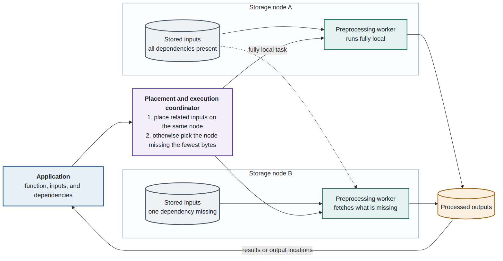

# Design Proposal

**Project:** Computational Storage

**Team:** Aakash, Harshada, Ivan, Jeehan, Mason

## 1. Problem

Many applications working with large datasets require preprocessing. In a distributed setup where storage and computation are not colocated, this can be expensive: relevant data must travel from storage nodes to compute nodes, be processed, and then be written back to storage. For terabyte-scale datasets with low-arithmetic-intensity preprocessing steps, these transfers can introduce an I/O bottleneck.

For instance, DROID is a key dataset used in many recent robotics developments. It contains approximately 8.7 TB of raw robot demonstrations, including videos, measured robot trajectories, actions, and language descriptions. It is used in robotics research and is the example dataset in Hugging Face's LeRobot conversion guide. Preparing the raw recordings for vision-language-action model training involves extracting video frames and robot trajectories, resizing frames to 320 × 180 pixels, and selecting the required state, action, and language fields. The [published RLDS version](https://droid-dataset.github.io/droid/the-droid-dataset) is approximately 1.7 TB. Reducing data near where it is stored could therefore avoid transferring much of the raw input.

The subsequent RLDS-to-LeRobot conversion provides a reference preprocessing pipeline. In LeRobot format, DROID stores robot states, actions, and episode metadata in Parquet files, while camera videos are stored separately as MP4 files. [Hugging Face's porting guide](https://huggingface.co/docs/lerobot/porting_datasets_v3) describes these stages:

| Stage | Work performed |
| --- | --- |
| Download | Obtain the RLDS files from Google Cloud Storage. |
| Convert shards | Read records, decode images, transform numerical fields, and create partial LeRobot datasets. |
| Aggregate | Combine partial datasets and reconcile metadata and indices. |
| Publish | Optionally upload the finished dataset to Hugging Face. |

Our project investigates how much network traffic can be avoided by moving preprocessing to storage nodes while reusing these existing transformations.

## 2. Proposed design

We will build a compute layer over Ceph that executes preprocessing on nodes where the required data is stored. A function-as-a-service interface will let an application specify a preprocessing function, its inputs, and the requested output. Workers running alongside storage services will process the data and either return results or save them to storage.

### Interface and dependencies

Preprocessing tasks may depend on multiple inputs. Preparing a raw DROID demonstration requires its videos, measured robot trajectories, and language descriptions. If these inputs are stored on different nodes, moving the worker onto a storage node alone may still leave substantial network transfers.

We propose two approaches:

1. **Place related inputs together.** A domain-specific mapping function will identify the inputs required by each task. The system will use this information to prioritize colocation and choose where additional replicas should be stored, so more tasks can access their dependencies on a single node.
2. **Fetch the fewest missing bytes.** When full colocation is not possible, the coordinator will choose an execution node that minimizes the missing input data it must fetch. For example, transferring a small language description to a node that already stores a large video is preferable to moving the video.

### Architecture

*The coordinator places related inputs together and selects workers based on input locality. A worker with incomplete dependencies fetches the missing data.*

### Storage and execution stack

Ceph will be deployed on Kubernetes using Rook. Datasets will be stored in CephFS, a shared filesystem mounted by workers inside isolated containers for reading inputs and writing results. Containers separate worker execution from Ceph's storage processes. Worker CPU and memory limits will bound resource consumption, and we will measure the effect of preprocessing on storage-service performance.

A scheduler will assign jobs to workers on each node. A background conversion service will use the same workers to prepare data as needed. Existing preprocessing functions will be reused so the comparison measures the effect of placement and execution location.

Ceph uses CRUSH to determine object placement under rules associated with its pools. These rules do not express the application's knowledge of which inputs belong together. We propose adapting the placement policy through custom rules informed by the application's dependency mapping. This requires relating file dependencies to Ceph's object and replica locations. We will verify the resulting read locality and account for any additional replication or data movement.

### Design choices

We make three principal choices:

- Build the compute layer over Ceph and CephFS to reuse distributed storage and filesystem access, allowing existing converters to use file paths instead of requiring them to use a direct object-storage API.
- Reuse existing transformations so a different converter does not confound the placement comparison.
- Use application-provided dependencies to guide both data placement and worker selection. Compared with placement-agnostic scheduling, this allows the coordinator to account for transfer costs, including partially local execution when full colocation is unavailable.

The comparison is with preprocessing on compute nodes separate from storage.

## 3. What makes this hard

The hardest part is turning domain-specific dependency information into physical data locality and using that locality to assign function calls. The placement policy must make related inputs available together, while the scheduler must distribute work evenly enough to avoid straggler nodes.

This requires more than connecting Ceph, Kubernetes, and a function interface. The system must connect the application's view of related files with Ceph's placement behavior, then choose execution locations that reduce transfers without concentrating too much work on a few storage nodes.

## 4. How you will know it worked

We will evaluate two DROID workloads: **raw DROID --> RLDS** and **RLDS --> LeRobot**. For each workload, we will compare preprocessing on separate compute and storage nodes with preprocessing on storage nodes, reusing the same transformations. The Hugging Face conversion workflow is the reference for the RLDS-to-LeRobot workload. For the Hugging Face conversion baseline, we will use the existing RLDS shards, which already group related demonstration data.

The primary measurements will be:

- Total cross-host network bytes during preprocessing, including input reads, missing dependencies, output writes, and replication, counting each transfer once.
- End-to-end execution time from job submission to readable processed outputs.

The comparison will use matching inputs, converter versions, output settings, worker resource limits, and cache conditions. We will check that both modes produce equivalent episode counts, selected state/action data, language, and image observations. Any additional placement or replication costs incurred before a job will be measured separately from execution traffic.

Hugging Face's porting guide estimates approximately 1.7 TB of RLDS input and approximately 400 GB of processed LeRobot data. These sizes motivate an optimistic goal of approximately **70% less network traffic while preserving overall execution time** for this conversion. We will evaluate the goal using measured network transfers and equivalent outputs rather than treating the dataset-size ratio as a measured network saving.

## 5. Milestones

| Demo | Date | Milestone | How we will demonstrate it |
| --- | --- | --- | --- |
| Demo 2 | 10/21 | A single-node Ceph cluster with an end-to-end load -> format conversion -> write-back path, a background conversion service, and an established separate-compute baseline. | Run the complete conversion on a compute node separate from storage using fixed inputs, verify the output, and record total runtime and cross-host bytes with a documented command to reproduce the baseline. |
| Demo 3 | 11/16 | Multiple storage nodes deployed with Kubernetes and Rook, a serverless API, and a first dependency-aware placement or scheduling policy. | Rerun the Demo 2 baseline approach on the same multi-node setup, then submit conversion jobs through the API and demonstrate reduced network transfer on matching inputs with equivalent outputs. Report runtime and transferred bytes for both modes. |
| Final | 12/09 | Refined conversion and locality policies, with broader evaluation across raw DROID --> RLDS and RLDS --> LeRobot. | Reproduce separate-compute and storage-node execution comparisons for both workloads, verify equivalent outputs, and present runtime and network-transfer graphs, including placement overhead and the effects of arithmetic intensity and straggler nodes. |

## 6. Risks

- **Physical locality.** A worker may run on a storage node while some required objects or dependencies are served remotely. We will verify storage locations and observed transfers, and evaluate both complete and incomplete dependency groups. Placement costs will be included in the assessment of the benefit.
- **Arithmetic intensity.** Some operations may be too computationally intensive to perform efficiently alongside storage services. We will profile conversion stages and compare execution modes to identify which operations benefit from computational storage and which justify transferring data to separate compute nodes.
- **Straggler nodes.** A locality-first policy may concentrate work on a busy node, while long episodes may delay overall job completion. The scheduler will consider worker load alongside missing-input bytes, and we will measure per-node work and task completion times to evaluate this tradeoff.
